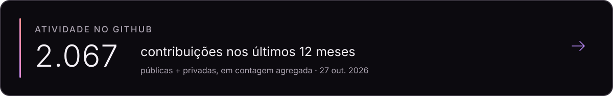

Engenheiro de Computação e desenvolvedor de software. Crio sistemas para domínios técnicos, com foco atual em engenharia automotiva.

## Skills

**Web:** Next.js · React · TypeScript · Tailwind CSS · Motion  
**Backend e desktop:** Node.js · Fastify · C# · .NET · WPF · MVVM  
**Dados e APIs:** PostgreSQL · Drizzle ORM · REST · ConnectRPC · Protocol Buffers

## Atividade no GitHub

  

*Dados agregados dos últimos 12 meses · atualização automática diária.*

<!-- O workflow requer o segredo GH_STATS_TOKEN com escopo read:user para incluir contribuições privadas. -->

## Projetos em destaque

### Ultimate ECU Database

Sistema de gestão para laboratório de eletrônica automotiva e base de engenharia para ECUs, conectores, pinouts e estoque.

[Repositório privado](https://github.com/g4rces/ultimateECUdatabase)

### Portfólio pessoal

Experiência web em Next.js, React e Motion, com uma apresentação tipográfica e projetos em preparação.

[Repositório privado](https://github.com/g4rces/portifolioReuel)
